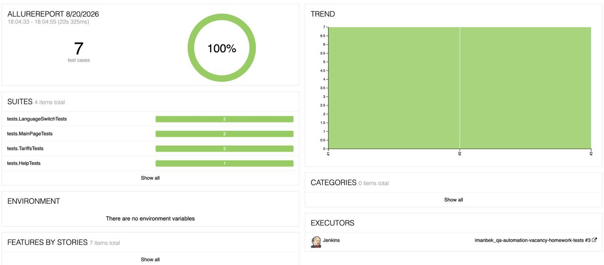
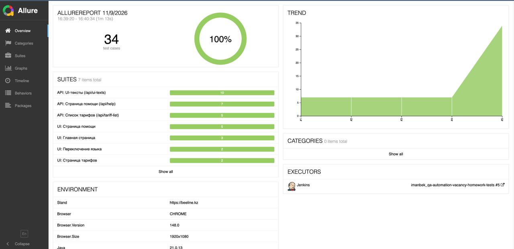

# Автоматизация тестирования [beeline.kz](https://beeline.kz): UI + API

Автотесты для сайта оператора **Beeline Казахстан** в одном проекте:
- **UI-тесты** — `Java` + `Selenide`, браузер на удалённом гриде `Selenoid`;
- **API-тесты** — `Rest Assured` (модели на Lombok, Specs, JSON-схема, Allure-листенер с custom-шаблонами);
- **UI + API:** ожидаемые данные для UI-теста тарифов берутся из API.

Результаты собираются в `Allure` (шаги, скриншот, page source, логи консоли, видеозапись прогона,
HTTP-запросы и ответы API). Ручные тест-кейсы: [docs/manual-test-cases.md](docs/manual-test-cases.md).

## :pushpin: Содержание

- [Использованный стек технологий](#computer-использованный-стек-технологий)
- [Что проверяется (тест-кейсы)](#-что-проверяется-тест-кейсы)
- [Сборка в Jenkins](#-сборка-в-jenkins)
- [Результаты последнего прогона](#-результаты-последнего-прогона)
- [Запуск тестов](#arrow_forward-запуск-тестов)
- [Параметры запуска](#-параметры-запуска)
- [Allure-отчёт](#-allure-отчёт)
- [Видеозапись прогона в Selenoid](#-видеозапись-прогона-в-selenoid)
- [Структура проекта](#-структура-проекта)

## :computer: Использованный стек технологий

<p align="center">
  
  
  
  
  
  
  
</p>

- Автотесты написаны на языке `Java 17` с использованием фреймворка [Selenide](https://selenide.org/).
- Сборщик проекта — `Gradle`.
- Тест-раннер — `JUnit 5` (JUnit Jupiter).
- Браузер запускается удалённо в [Selenoid](https://aerokube.com/selenoid/).
- Отчётность — [Allure Report](https://allurereport.org/) (плагин + `aspectjWeaver` для аннотации `@Step`).
- Применён паттерн **Page Object** с fluent-методами (`return this;`).

**Содержание Allure-отчёта по каждому тесту:**
* шаги теста;
* скриншот страницы на последнем шаге;
* page source;
* логи браузерной консоли;
* видео выполнения автотеста (из Selenoid).

## 🧪 Что проверяется (тест-кейсы)

Тестируемое приложение — production-сайт `https://beeline.kz` (Nuxt/Vue SPA, локали `/ru` и `/kk`).

| # | Класс / тест | Проверка |
|---|--------------|----------|
| 1 | `MainPageTests.mainPageShouldBeOpened` | Главная открывается, `header` виден, URL содержит `beeline.kz` |
| 2 | `MainPageTests.mainPageShouldHaveCorrectTitle` | `<title>` страницы содержит «Beeline» |
| 2а | `MainPageTests.personalAccountShouldShowMovedToJanymdaMessage` | Кнопка «Личный кабинет» показывает сообщение «Личный кабинет переехал в приложение «Janymda»» с QR-кодом |
| 3 | `TariffsTests.tariffsPageShouldBeOpened` | На странице тарифов виден заголовок «Тарифы для смартфона» |
| 4 | `TariffsTests.firstTariffFromApiShouldBeDisplayed` | Название первого тарифа берётся из `/api/tariff-list` и проверяется на странице тарифов (UI + API) |
| 5 | `HelpTests.helpTitleFromApiShouldBeDisplayed` | Заголовок из `/api/help` отображается на странице помощи (UI + API) |
| 5а | `HelpTests.firstCategoryFromApiShouldBeDisplayed` | Название первой категории из `/api/help` отображается на странице помощи (UI + API) |
| 5б | `HelpTests.searchBlockFromApiShouldBeDisplayed` | Поле поиска («Что ищете?») и быстрые варианты из `/api/help` отображаются на странице помощи (UI + API) |
| 5в | `HelpTests.quickVariantLinksShouldMatchApi` | Ссылки быстрых вариантов поиска на странице совпадают с `/api/help` (UI + API) |
| 5г | `HelpTests.quickVariantShouldOpenCategory` | Клик по быстрому варианту («узнать свой тариф») открывает нужную категорию справки |
| 6–7 | `LanguageSwitchTests.shouldSwitchLanguage` (параметризованный) | Переключение языка `kk → ru` и `ru → kk`, URL содержит целевую локаль |

### API-тесты (`@Tag("api")`)

Тестируются публичные `GET`-эндпоинты (Strapi CMS сайта). Везде проверяются статус `200`, `Content-Type: application/json` и время ответа < 5 с (`ResponseSpecification`).

**`GET /api/ui-texts`** — `UiTextsApiTests`

| Тест | Проверка |
|------|----------|
| `responseShouldMatchJsonSchema` (ru, kk) | Ответ соответствует JSON-схеме `schemas/ui-texts-schema.json` |
| `allItemsShouldHaveRequestedLocale` (ru, kk) | Список не пуст; у каждого элемента `locale` = запрошенной, `code` и `text` заполнены |
| `codesShouldNotHaveNewDuplicates` (ru, kk) | `code` не дублируется. Известные дубли в `ru` (`checkAddressCheckButton`, `checkAddressConnectionAvailable`) занесены в исключения |
| `paginationShouldBeConsistent` (ru, kk) | `meta.pagination.page = 1`, `total` ≥ числа элементов в `data` |
| `pageSizeShouldLimitResults` (1, 5) | `pagination[pageSize]` ограничивает выдачу |

**`GET /api/tariff-list`** — `TariffListApiTests` (локаль `ru`)

| Тест | Проверка |
|------|----------|
| `tariffListShouldBeReturnedForRussianLocale` | `locale = ru`, есть группы тарифов |
| `smartphoneTabShouldPointToTariffsPage` | Вкладка «Тарифы для смартфона» ведёт на `/ru/products/tariffs` |
| `everyGroupShouldHaveTitleAndTariffs` | У каждой группы есть название и тарифы |
| `everyTariffShouldHaveTitleSlugAndCost` | У тарифа заполнены `title`, `slug`, `costBlock.newCost ≥ 0` |
| `tariffSlugsShouldBeUnique` | `slug` тарифов не повторяются |

**`GET /api/help`** — `HelpApiTests` (локаль `ru`)

| Тест | Проверка |
|------|----------|
| `helpTitleShouldBeReturned` | `locale = ru`, `title` = «Как мы можем помочь?» |
| `categoriesShouldContainMainSections` | Есть категории `mobile` и `homeinternet` |
| `everyCategoryShouldHaveTitleSlugAndSubCategories` | У категории заполнены `title`, `slug`, есть подкатегории |
| `slugsShouldBeUnique` | `slug` категорий уникальны; `slug` подкатегорий уникальны внутри категории |
| `searchBlockShouldBeFilled` | У блока поиска есть `placeholder` и быстрые варианты с `label` и `url` |
| `searchVariantLinksShouldPointToExistingCategories` | Ссылки `/help?category=<slug>` ведут на существующие категории |
| `seoShouldHaveTitle` | `seo.title` заполнен |

**`POST /telco/payment`** — `PaymentRequestModelTests` (без обращения к сайту)

| Тест | Проверка |
|------|----------|
| `requestShouldBeSerializedToExpectedJson` | Модель `PaymentRequest` (Lombok `@Builder`) сериализуется в JSON с полями `msisdn`, `amount`, `captchaCode` нужных типов |
| `siteJsonShouldBeDeserializedToModel` | JSON формата сайта десериализуется в модель и равен собранной через builder |

> **Почему запрос не отправляется:** `POST /telco/payment` — оплата (финансовая операция) на боевом сайте, защищённая капчей
> (`captchaCode`), поэтому он не вызывается из автотестов. Для него сделана только модель тела запроса и проверка её формата.

> Нагрузочное тестирование боевого сайта не проводится: только небольшое число безопасных `GET`-запросов.
> Если сервер (WAF) ответит `403`, это ограничение стороны сайта.

## 🔧 Сборка в Jenkins

Автотесты запускаются на CI-сервере Jenkins; по завершении сборки публикуется Allure-отчёт.

- **Jenkins job:** [imanbek_qa-automation-vacancy-homework-tests](https://jenkins.qa.guru/job/imanbek_qa-automation-vacancy-homework-tests/)
- **Allure-отчёт (последняя сборка):** [Allure Report](https://jenkins.qa.guru/job/imanbek_qa-automation-vacancy-homework-tests/allure/)

## ✅ Результаты последнего прогона

Все **36 тестов** (12 UI + 24 API) пройдены успешно (по данным последнего локального прогона `./gradlew clean test`):

| Набор | Тестов | ✅ Passed | ❌ Failed | ⏭ Skipped |
|-------|:------:|:--------:|:--------:|:---------:|
| UI (`uiTest`) | 12 | 12 | 0 | 0 |
| API (`apiTest`) | 24 | 24 | 0 | 0 |
| **Всего** | **36** | **36** | **0** | **0** |

<p align="center">
  
</p>

## :arrow_forward: Запуск тестов

Требуется установленный **JDK 17**.

**Все тесты (UI в Selenoid + API):**
```bash
./gradlew clean test
```

**Только UI / только API:**
```bash
./gradlew clean uiTest
./gradlew clean apiTest
```

**Локальный запуск в своём браузере** (без грида):
```bash
./gradlew clean test -Dremote= -Dheadless=false
```

**Запуск одного класса / одного теста:**
```bash
./gradlew test --tests "tests.ui.MainPageTests"
./gradlew test --tests "tests.ui.MainPageTests.mainPageShouldHaveCorrectTitle"
```

> Если `JAVA_HOME` указывает не на JDK 17, задайте его явно:
> `JAVA_HOME=/Library/Java/JavaVirtualMachines/jdk-17.jdk/Contents/Home ./gradlew clean test`

## ⚙️ Параметры запуска

Параметры передаются через `-D<key>=<value>` (см. `TestBase`):

| Параметр | Назначение | По умолчанию |
|----------|------------|--------------|
| `baseUrl` | Базовый URL тестируемого приложения (используется и в UI, и в API-тестах) | `https://beeline.kz` |
| `browser` | Браузер | `chrome` |
| `browserVersion` | Версия браузера (должна быть среди доступных на Selenoid: `/status`) | `157.0` |
| `browserSize` | Размер окна | `1920x1080` |
| `headless` | Headless-режим | `false` |
| `remote` | URL удалённого грида (Selenoid). Пусто → локальный запуск | Selenoid (см. `TestBase`) |

## 📊 Allure-отчёт

Опубликованный отчёт последней сборки доступен в Jenkins: [Allure Report](https://jenkins.qa.guru/job/imanbek_qa-automation-vacancy-homework-tests/4/allure/)

Сгенерировать и открыть отчёт локально:
```bash
./gradlew test
allure serve build/allure-results
```

### Overview
<p align="center">
  
</p>

### Результат выполнения теста
<p align="center">
  
</p>

## 🎬 Видеозапись прогона в Selenoid


<p align="center">
  
</p>

## 🗂 Структура проекта

```
src/test
├── java
│   ├── api                    # вызовы API-эндпоинтов (UiTextsApi, TariffsApi, HelpApi)
│   ├── models                 # Lombok-модели ответов API
│   ├── specs
│   │   └── BaseSpec.java      # RequestSpecification / ResponseSpecification
│   ├── helpers
│   │   ├── Attach.java                 # вложения в Allure: скриншот, source, логи, видео
│   │   └── CustomAllureListener.java   # rest-assured листенер с custom-шаблонами
│   ├── pages
│   │   ├── MainPage.java          # главная: header, заголовок
│   │   ├── TariffsPage.java       # тарифы: заголовок, проверка тарифа по названию
│   │   ├── HelpPage.java          # помощь: «Как мы можем помочь?»
│   │   └── components
│   │       └── LanguageSwitcher.java   # переключатель языка (kk/ru)
│   └── tests
│       ├── ui
│       │   ├── TestBase.java          # конфигурация Selenide/Selenoid + Allure listener (@Tag("ui"))
│       │   └── MainPageTests / TariffsTests / HelpTests / LanguageSwitchTests
│       └── api                        # @Tag("api")
│           └── UiTextsApiTests / TariffListApiTests / HelpApiTests
└── resources
    ├── schemas/ui-texts-schema.json          # JSON-схема ответа
    └── tpl/http-request.ftl, http-response.ftl   # шаблоны вложений Allure
```

Ручные тест-кейсы — в `docs/manual-test-cases.md`.
